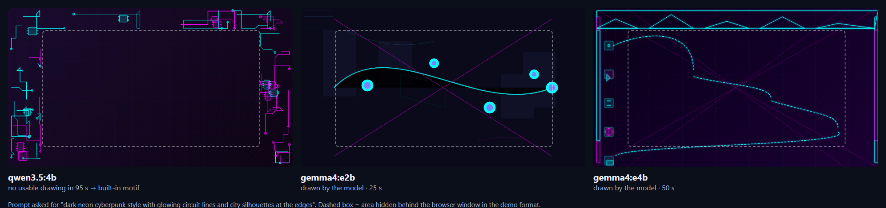

# Model comparison: Qwen 3.5 4B vs Gemma 4 E2B vs Gemma 4 E4B (November 2026)

**Short version:** on this machine Gemma 4 E2B is the fastest but writes the weakest plan and draws its background in the wrong place; Gemma 4 E4B is the best all-rounder (good plan, the only usable model-drawn background) but is the heaviest and once returned broken JSON; Qwen 3.5 4B writes the most concise, accurate captions but cannot draw a background in time, so use it with `--backdrop motif` (its default for local models). Navigation was identical for all three.

One run per model on one machine and one app: treat this as an anecdote with numbers, not a benchmark. Please add your own runs (see *Reproduce* below).

## Setup

| | |
| --- | --- |
| Hardware | AMD Ryzen 7 6800H, 16 GB RAM, NVIDIA RTX 3060 Laptop GPU (6 GB), Windows 11 |
| Runtime | Ollama 0.40.18, all models fully on the GPU |
| Models | `qwen3.5:4b` (3.3 GB), `gemma4:e2b` (4.6 GB), `gemma4:e4b` (6.6 GB), from the official Ollama library |
| App | A real Next.js + FastAPI wizard (bill-of-quantities review): upload a JSON file, review, resolve findings, price, upload a spreadsheet, set the margin, export |
| Flags | `--backdrop generate` (the model draws the background itself), `--no-render` (recording only, rendering is model-independent) |
| Prompt | "Show the full cycle …: import, review the findings, evaluate prices, set the margin and export. All titles and captions in English. Dark neon cyberpunk style with glowing circuit lines and city silhouettes at the edges." |

Not tested: the **LiteRT** build of Gemma 4 E2B. It is made for Google's LiteRT-LM runtime (on-device), Ollama cannot load it and it does not offer an OpenAI-compatible API, so CTV cannot use it without an adapter. Ollama's `gemma4:e2b` / `gemma4:e4b` are the instruction-tuned models in GGUF form.

## Speed (seconds, single run)

| Model | Plan | Background | Recording | Total |
| --- | ---: | ---: | ---: | ---: |
| qwen3.5:4b | 24.7 | 94.8 (no usable drawing) | 61.8 | 225.2 |
| gemma4:e2b | **14.1** | **24.7** | **44.7** | **121.2** |
| gemma4:e4b | 24.5 | 49.9 | 68.4 | 167.0 |

- *Recording* depends on the pacing each model chose in its plan, not only on model speed: E2B picked fast scrolling (850 ms per step), Qwen slow (2400 ms), E4B medium-slow (2000 ms). The prompt did not ask for a pace.
- Qwen's total is inflated by a background drawing that never finished in time (≈95 s, then the built-in motif). Qwen also ran while the two Gemma models were downloading.

## Plan / story

**Qwen 3.5 4B:** short, factual, all within limits. "LV Scout Full Cycle", scenes like *Upload Bill: Import LV as GAEB, Excel, PDF or JSON*, *Resolve Findings: Score 7.7/10 with error details*. Six scenes. Best for captions that fit on screen.

**Gemma 4 E2B:** marketing tone ("Stop losing money on construction bids…"). Captions were too long for the 68-character limit and got cut mid-word in the video (*"…across thousands of item"*); CTV now cuts at a word boundary instead. Some claims are generic rather than taken from the app ("historical data and market indices").

**Gemma 4 E4B:** balanced and accurate, all within limits: *Review Findings: AI reviews items, flags risks, and identifies critical errors.* Merged two steps into one (five scenes). Title was generic ("AI BoQ Review: Full Cycle").

All three wrote English as requested and chose the same neon cyan/magenta palette.

## Navigation

Identical: all three completed the same 12 steps (both uploads, all screens, export) with no wrong clicks. In CTV the *path* is chosen by DOM rules; the model only decides what button labels mean. Label roles were nearly the same; E2B once labelled the product logo link as a forward action (harmless here). E4B's label classification was the slowest (about 5 s of waiting in total).

## Background (`--backdrop generate`)



- **Qwen 3.5 4B:** no valid SVG within the time limit; the built-in circuit motif was used. It looks best of the three, but it is not the model's drawing.
- **Gemma 4 E2B:** drew a valid SVG in 25 s, but almost everything sits in the **center**, which the browser window covers in the demo format. No circuits, no city silhouettes.
- **Gemma 4 E4B:** drew a frame along the edges (a truss across the top, lines and icons down the side) in 50 s. Closest to the brief, though still no city silhouettes.

## Reliability

Gemma 4 E4B's **first** run crashed: the plan came back as malformed JSON and CTV had no retry for that step. Fixed in this release (JSON repair plus one retry on a parse error); the second run went through cleanly. Qwen and E2B produced valid JSON first time.

## Recommendations

| You want | Use |
| --- | --- |
| Fastest local runs | `gemma4:e2b` with `--backdrop motif` |
| Best captions on a small model | `qwen3.5:4b` with `--backdrop motif` (the default for local models) |
| The model to draw the background itself | `gemma4:e4b` with `--backdrop generate` |
| A good all-rounder if you have ~7 GB for the model | `gemma4:e4b` |

## Findings for CTV itself

- `--backdrop generate` accepts any valid drawing; it should also check that the drawing reaches the edges (E2B's centered art is hidden behind the window). Follow-up.
- Over-long captions are now cut at a word boundary.
- Plan JSON is now repaired and retried once.
- Models without a thinking mode no longer fail the background step (CTV retries without `think`).

## Reproduce

```bash
ollama pull gemma4:e2b
node scripts/bench-models.cjs --models qwen3.5:4b,gemma4:e2b,gemma4:e4b
```

Without `--file` it uses the bundled `examples/hello-wizard`; pass `--file`, `--upload` and `--prompt` to test your own app. Results land in `out/bench/<timestamp>/` (`results.json`, `backdrops.png`, one log per model). Please share yours in [issue #11](https://github.com/Anatomik5/codetovideo/issues/11).
